# Repository Release Readiness Checker

A Node.js and Express application that analyzes a GitHub repository through six rule-based checks, calculates a deterministic readiness score, and stores an evidence-oriented report. Users can run an analysis in the API request or submit it to a BullMQ worker and poll for completion.

The project is designed as a learning-sized backend: PostgreSQL access uses parameterized SQL through `pg`, and the browser UI is plain HTML, CSS, and JavaScript.

## Features

- Six checks: tests signals, secrets, Docker, README/documentation, CI/CD, and commit hygiene.
- Fixed weighted scoring and `ready`, `needs_work`, or `not_ready` verdicts.
- Gemini-generated risk and recommendation explanations with server-side shape and evidence-reference validation. A deterministic report is used when Gemini is unavailable or returns an invalid response.
- JWT authentication, request validation, security headers, and stricter authentication rate limits.
- Synchronous analysis and asynchronous analysis through BullMQ and Redis.
- User-scoped report history and retrieval, plus commit-SHA cache reuse.
- PostgreSQL JSONB persistence.
- Docker Compose orchestration for the API, Worker, PostgreSQL, and Redis.
- Minimal browser UI served by Express at `/`.

## Architecture

```mermaid
flowchart LR
  Browser[Browser UI] --> API[Express API]
  API --> Auth[JWT authentication and validation]
  Auth --> Sync[POST /api/check]
  Auth --> Async[POST /api/check/async]
  Sync --> Orchestrator[Shared analysis orchestrator]
  Async --> Redis[BullMQ queue in Redis]
  Redis --> Worker[Worker process]
  Worker --> Orchestrator
  Orchestrator --> GitHub[Octokit snapshot service]
  GitHub --> Checkers[Six independent checkers]
  Checkers --> Scorer[Deterministic weighted scorer]
  Scorer --> Report[Gemini report generation]
  Report --> Validate[Schema and evidence-reference validation]
  Validate --> Fallback[Rule-based fallback when needed]
  Validate --> Store[Parameterized SQL check store]
  Fallback --> Store
  Store --> PostgreSQL[(PostgreSQL JSONB)]
```



## Analysis flows

### Synchronous request

1. The API validates the HTTPS GitHub URL and verifies the bearer token.
2. The orchestrator resolves the default-branch HEAD SHA.
3. It checks the authenticated user’s cache for the repository and SHA. `force: true` or `?force=true` bypasses reuse.
4. If there is no cache hit, Octokit fetches the repository snapshot pinned to that SHA.
5. Six independent checkers run concurrently. A checker error becomes a visible failing finding; it is not treated as a pass.
6. The scorer calculates the authoritative weighted score and verdict.
7. Gemini creates report explanations when configured. The server validates the response shape and its finding IDs and file paths. Invalid or unavailable responses use the rule-based fallback.
8. The report and checker results are stored as JSONB in PostgreSQL and returned to the client.

### Asynchronous request

1. `POST /api/check/async` validates and authenticates the request, then adds one BullMQ job for the complete analysis.
2. The Worker consumes the job and calls the same orchestrator used by the synchronous route.
3. BullMQ retries failed jobs with bounded attempts and exponential backoff.
4. The authenticated user polls `GET /api/check/jobs/:jobId` for status and, on completion, the result.

PostgreSQL stores reports and history. Redis stores queue/job state. Compose enables Redis append-only persistence and named volumes for PostgreSQL and Redis.

## Scoring

| Checker        | Weight |
| -------------- | -----: |
| Secrets        |    25% |
| Tests          |    20% |
| CI/CD          |    20% |
| Docker         |    15% |
| README         |    10% |
| Commit hygiene |    10% |

The score is rounded to an integer. Verdict thresholds are `ready` (80–100), `needs_work` (50–79), and `not_ready` (0–49). Gemini does not choose or change the score or verdict.

## Database overview

The schema is in [`database/init.sql`](database/init.sql); it is mounted into the Postgres initialization directory by Compose.

| Table    | Purpose                                                                                                                                |
| -------- | -------------------------------------------------------------------------------------------------------------------------------------- |
| `Users`  | Usernames, unique emails, bcrypt password hashes, and creation timestamps.                                                             |
| `Checks` | User-owned repository checks, status, commit SHA, score, verdict, cache metadata, report JSONB, checker-results JSONB, and timestamps. |

Indexes support user/repository/SHA cache lookup, user history pagination, and verdict filtering. Query values are parameterized through `pg`.

PostgreSQL runs `init.sql` only when it initializes an empty data directory. Existing named volumes are preserved across `docker compose down`; apply the relevant SQL migration manually when upgrading an existing database schema.

## Requirements

- Node.js 20 and npm for local development.
- Docker with Docker Compose for the full local stack.
- A GitHub token is optional for public repositories and helps avoid unauthenticated API rate limits.
- A Gemini API key is optional. Without it, report generation uses the deterministic fallback.

## Environment configuration

Copy `.env.example` to `.env` and set local values. Never commit `.env` or real credentials.

| Variable(s)                                                             | Purpose                                                                                                                                |
| ----------------------------------------------------------------------- | -------------------------------------------------------------------------------------------------------------------------------------- |
| `PORT`, `NODE_ENV`, `CLIENT_ORIGIN`                                     | HTTP port, runtime mode, and allowed browser origin.                                                                                   |
| `DATABASE_URL`                                                          | PostgreSQL connection string for direct local runs. Compose constructs the container URL from `DB_USER`, `DB_PASSWORD`, and `DB_NAME`. |
| `DB_POOL_MAX`, `DB_IDLE_TIMEOUT_MS`, `DB_CONN_TIMEOUT_MS`               | PostgreSQL connection-pool limits and timeouts.                                                                                        |
| `JWT_SECRET`, `JWT_EXPIRES_IN`                                          | Required signing secret and token lifetime.                                                                                            |
| `RATE_LIMIT_WINDOW_MS`, `RATE_LIMIT_MAX_GENERAL`, `RATE_LIMIT_MAX_AUTH` | General API and stricter authentication rate limits.                                                                                   |
| `GITHUB_TOKEN`                                                          | Optional Octokit token for authenticated GitHub API requests.                                                                          |
| `GEMINI_API_KEY`, `GEMINI_MODEL`                                        | Optional report-generation key and model override.                                                                                     |
| `REDIS_URL` or `REDIS_HOST`, `REDIS_PORT`, `REDIS_PASSWORD`             | Redis connection settings; Compose points API and Worker at its Redis service.                                                         |
| `BULLMQ_CONCURRENCY`                                                    | Maximum number of jobs processed concurrently by a Worker.                                                                             |

## Run locally with Docker Compose

Create the local environment file and replace the JWT placeholder with a strong random value. Add real API keys only if you want authenticated GitHub requests or Gemini reports.

```sh
cp .env.example .env
docker compose up --build -d
```

Open [http://localhost:3000](http://localhost:3000). The Compose stack waits for PostgreSQL and Redis health checks before starting the API and Worker. To follow logs:

```sh
docker compose logs -f api worker
```

To stop the stack while retaining its data volumes:

```sh
docker compose down
```

Compose uses `DB_USER`, `DB_PASSWORD`, and `DB_NAME` to configure Postgres and builds an internal `DATABASE_URL` for the API and Worker. If credentials contain URL-reserved characters, percent-encode them when forming a connection URL for non-Compose local runs.

## Run the API and Worker directly

Start PostgreSQL and Redis separately, set `DATABASE_URL` and Redis settings in `.env`, install dependencies, and initialize the schema:

```sh
npm ci
psql "$DATABASE_URL" -f database/init.sql
npm run dev
```

In a second terminal, start the Worker:

```sh
node workers/check_worker.js
```

## API reference

All check routes require `Authorization: Bearer <token>`. Responses use a success envelope (`success`, optional `message`, and `data`) or an error envelope (`success: false`, `error.message`, and optional validation details).

| Method and path              | Auth | Description                                                                      |
| ---------------------------- | ---- | -------------------------------------------------------------------------------- |
| `GET /health`                | No   | Liveness probe.                                                                  |
| `GET /health/db`             | No   | PostgreSQL readiness probe.                                                      |
| `POST /api/auth/register`    | No   | Register with `username`, `password`, and optional `email`.                      |
| `POST /api/auth/login`       | No   | Authenticate and receive a JWT.                                                  |
| `POST /api/check`            | Yes  | Run analysis synchronously. Body: `repoUrl`, optional boolean `force`.           |
| `POST /api/check/async`      | Yes  | Enqueue one complete analysis; returns HTTP 202 and a `jobId`.                   |
| `GET /api/check/jobs/:jobId` | Yes  | Read an owned job’s state, result, or failure reason.                            |
| `GET /api/check/history`     | Yes  | Paginated user history; optional `page`, `limit`, `verdict`, and `repo` filters. |
| `GET /api/check/:id`         | Yes  | Retrieve a report owned by the authenticated user.                               |

### Example requests

Register and log in:

```sh
curl -X POST http://localhost:3000/api/auth/register \
  -H 'Content-Type: application/json' \
  -d '{"username":"demo_user","password":"change-this-password"}'

curl -X POST http://localhost:3000/api/auth/login \
  -H 'Content-Type: application/json' \
  -d '{"username":"demo_user","password":"change-this-password"}'
```

Run a synchronous check (replace `$TOKEN` with the returned token):

```sh
curl -X POST http://localhost:3000/api/check \
  -H "Authorization: Bearer $TOKEN" \
  -H 'Content-Type: application/json' \
  -d '{"repoUrl":"https://github.com/owner/repository"}'
```

Enqueue and poll an asynchronous check:

```sh
curl -X POST http://localhost:3000/api/check/async \
  -H "Authorization: Bearer $TOKEN" \
  -H 'Content-Type: application/json' \
  -d '{"repoUrl":"https://github.com/owner/repository"}'

curl http://localhost:3000/api/check/jobs/JOB_ID \
  -H "Authorization: Bearer $TOKEN"
```

A synchronous result includes `checkId`, `repoName`, `headSha`, `ruleScore`, `verdict`, `checkerBreakdown`, `report`, `checkerResults`, and `createdAt`. A cached response includes `cached: true` and reuses the stored result for that user, repository, and SHA.

## Tests and CI

Run unit and HTTP tests, lint, and formatting checks:

```sh
npm test
npm run lint
npm run format:check
```

The PostgreSQL/Redis integration suite is enabled with `RUN_SERVICE_INTEGRATION=true` and requires reachable services described by `DATABASE_URL` and `REDIS_URL`. It exercises real registration/login, analysis persistence and cache reuse, and a Worker retry/ownership flow while mocking Octokit and Gemini. The GitHub Actions workflow starts these services, runs the integration suite, and builds the API and Worker Docker images.

To build the local images:

```sh
docker compose build
```

## Design choices

- **Rules own the score.** Deterministic scoring keeps the result explainable and prevents generated text from changing the release verdict.
- **One orchestrator serves both entry points.** Synchronous and queued analysis share the same snapshot, checker, scoring, report, and persistence flow.
- **One queue job represents one analysis.** The Worker processes a complete repository check instead of splitting it into checker-level jobs.
- **Raw SQL keeps persistence explicit.** Parameterized queries avoid an ORM layer and make the user scope and cache conditions visible.
- **Cache identity includes user, normalized repository URL, and commit SHA.** This allows repeat requests to reuse an unchanged revision without sharing reports across users.
- **The UI stays small.** Express serves static files; there is no frontend framework or separate build pipeline.

## Limitations

- Checker results are repository signals. The application does not clone a target repository, execute its tests, or measure its test coverage.
- Secret detection uses common patterns and risky paths; it is not a guarantee that a repository contains no credentials. Content scanning is bounded to at most 50 eligible files, each no larger than 100 KB.
- Commit hygiene examines a limited recent commit window rather than the repository’s complete history.
- AI report validation constrains the response schema and referenced finding IDs/file paths. It cannot mathematically guarantee every sentence in generated prose is correct; the fallback is rule-based.
- Cache reuse is scoped to the authenticated user, repository URL, and current HEAD SHA. `force` can request a fresh analysis.
- Redis job status is retained for a bounded period by BullMQ cleanup settings; PostgreSQL remains the report-history store.
- Local test environments without PostgreSQL and Redis skip the service integration suite. CI runs it with service containers.
- This repository documents local operation and CI verification; it does not include a hosted deployment setup.
